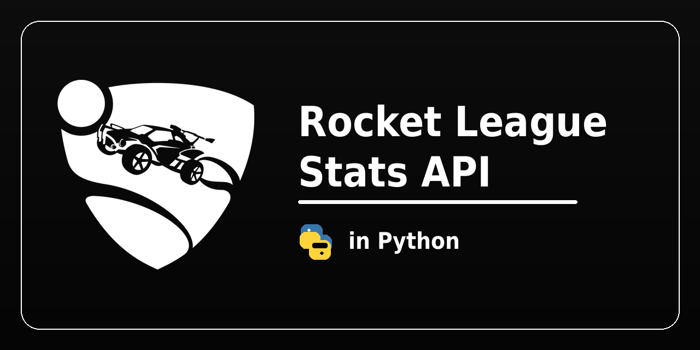

# Rocket League Stats API
[](https://github.com/psf/black) [](https://pypi.org/project/rlstatsapi/) [](https://github.com/manucabral/rlstatsapi/actions/workflows/pylint.yml)


`rlstatsapi` is a small Python client for reading live Rocket League Stats API events over a local TCP socket.

- Full docs: [manucabral.github.io/rlstatsapi](https://manucabral.github.io/rlstatsapi/)
- Release history: [CHANGELOG.md](CHANGELOG.md)

## Install

From [PyPI](https://pypi.org/project/rlstatsapi/):

```bash
pip install rlstatsapi
```

With the faster JSON backend ([orjson](https://github.com/ijl/orjson), about twice the decoding speed):

```bash
pip install "rlstatsapi[fast]"
```

From GitHub:

```bash
pip install git+https://github.com/manucabral/rlstatsapi.git
```

## Rocket League setup

Automatic setup from Python:

```python
from rlstatsapi import configure_stats_api

configure_stats_api(enabled=True, port=49123, packet_send_rate=30)
```

Manual setup:

`Documents\My Games\Rocket League\TAGame\Config\TAStatsAPI.ini`

```ini
[TAGame.MatchStatsExporter_TA]
Port=49123
PacketSendRate=30
```

In both cases, restart Rocket League after changing the config file.

Config discovery is currently Windows-first and targets common user config locations.

## Quick start

```python
import asyncio
from rlstatsapi import StatsClient


async def main() -> None:
    async with StatsClient() as client:
        client.on_any(lambda msg: print(msg.event, msg.data))
        await asyncio.Event().wait()


asyncio.run(main())
```

## Demos

### All events


### UI


## Commands

The game accepts commands on the same socket (Rocket League v2.72 or newer):

```python
async with StatsClient() as client:
    await client.wait_for("UpdateState")
    await client.set_hud_visibility(False)
    await client.change_pov(focus="Ball", perspective="Fly")
```

Available: `change_pov`, `load_replay`, `seek_replay`, `set_game_speed`,
`set_hud_visibility` and `set_match_paused`. See the
[commands guide](https://manucabral.github.io/rlstatsapi/commands/).

## CLI

```bash
rlstatsapi status
rlstatsapi enable --port 49123 --rate 30
rlstatsapi listen --event GoalScored
rlstatsapi send SetHUDVisibility '{"bVisible": false}'
```

You can also listen to multiple events:

```bash
rlstatsapi listen --event GoalScored --event MatchEnded --event MatchCreated
```

## Typing

For the best editor experience, use `cast_event_data(...)` or `msg.as_type(...)`.

```python
from rlstatsapi.models import EventMessage
from rlstatsapi.types import GoalScoredPayload, cast_event_data


def on_goal(msg: EventMessage) -> None:
    data: GoalScoredPayload = cast_event_data("GoalScored", msg.data)
    print(data.get("Scorer", {}).get("Name"))
```

## More

- Full docs: [manucabral.github.io/rlstatsapi](https://manucabral.github.io/rlstatsapi/)
- Examples: [examples/](examples)
- Release history: [CHANGELOG.md](CHANGELOG.md)

## Notes

- The client uses the game's TCP socket (`Port`). The WebSocket listener (`WebPort`) is not needed.
- Some fields, such as `MatchGuid`, are only present in online/LAN contexts.

## Disclaimer

This project is an independent, community-made library and is **not affiliated with, endorsed by, or sponsored by Psyonix or Epic Games**.

Rocket League and related trademarks are the property of their respective owners.  
Use this library at your own risk and in compliance with Rocket League’s terms and policies.

## Contributors

<a href="https://github.com/manucabral/rlstatsapi/graphs/contributors">
  
</a>
